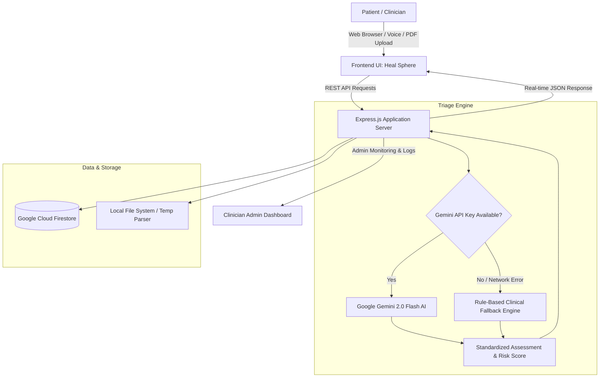

# 🏥 Heal Sphere — AI-Powered Healthcare Triage & Clinical Decision Support System

[](https://nodejs.org/)
[](https://expressjs.com/)
[](https://aistudio.google.com/)
[](https://firebase.google.com/)
[](https://developer.mozilla.org/en-US/docs/Web/JavaScript)
[](LICENSE)
[](#)

**Heal Sphere** is an intelligent, full-stack healthcare triage and clinical decision support platform. Powered by **Google Gemini 2.0 Flash AI** and fortified with a robust, zero-downtime offline rule-based clinical engine, Heal Sphere rapidly assesses patient symptoms, extracts vital parameters from medical documents, evaluates critical risk indicators, and provides prioritized triage tiers in real time.

---

## 🌟 Key Capabilities & Highlights

- 🤖 **Dual-Engine Triage Architecture**
  - **Primary**: Google Gemini 2.0 Flash via `@google/generative-ai` SDK for contextual NLP condition differential, severity classification, and clinical explanations.
  - **Fallback**: Built-in deterministic clinical rule engine covering **50+ acute and chronic symptom patterns** — operates seamlessly offline with zero API key configuration.
- 📄 **Multimodal Medical Report Extraction**
  - Instant automated analysis of uploaded medical records (PDFs/images) using AI parsing to extract patient demographics, clinical history, and baseline vitals.
  - A verifiable sample report ([`test_Patient_Medical_Report_HealSphere.pdf`](test_Patient_Medical_Report_HealSphere.pdf)) is provided for immediate out-of-the-box validation.
- 🎙️ **Voice-to-Text Clinical Intake**
  - Hands-free, speech-driven symptom dictation powered by the browser-native Web Speech API.
- 🌐 **7-Language Localization**
  - Complete multi-language UI and AI translation suite supporting **English, Spanish, French, German, Hindi, Mandarin Chinese, and Arabic**.
- 🩺 **Dynamic Risk Scoring & Vital Signs Analysis**
  - Real-time calculation of composite risk scores (0–100) factoring in age, heart rate, blood pressure, SpO₂, temperature, and symptom severity.
  - Triaged into color-coded clinical priorities: **HIGH** (immediate attention), **MEDIUM** (urgent care), and **LOW** (routine/home care).
- 📊 **Unified Clinician Admin Dashboard**
  - Live patient monitoring portal (`/admin`) equipped with status pills, interactive filtering (High Risk, Today, Follow-ups), search, and comprehensive assessment logs.
- 👤 **Patient Portal**
  - Dedicated patient portal (`/patient`) for individuals to look up previous triage results, follow-up timelines, and self-care recommendations.
- ☁️ **Cloud Persistence & Real-Time Sync**
  - Fully integrated with Google Cloud Firestore for persisting triage evaluations, patient profiles, and medical reports.

---

## 🏗️ System Architecture



---

## 🛠️ Technology Stack

| Layer | Technologies & Libraries | Purpose |
|---|---|---|
| **Backend Core** | Node.js, Express.js | High-throughput REST API and static client serving |
| **Generative AI** | Google Gemini 2.0 Flash (`@google/generative-ai`) | Multimodal report comprehension, clinical differential |
| **Database & Auth**| Google Cloud Firestore, Firebase Auth | Secure cloud persistence and staff dashboard authorization |
| **File Handling** | Multer | Multipart/form-data handling for PDF/report uploads |
| **Frontend Web** | HTML5, Vanilla JavaScript (ES6+), CSS3 | High-performance, lightweight UI without heavy framework overhead |
| **Styling & Design**| Glassmorphism, CSS Custom Properties, Inter typography | Sleek, modern, responsive clinical user experience |
| **Speech Engine** | Web Speech API | Client-side natural speech-to-text symptom intake |

---

## 📂 Project Directory Structure

```text
Heal-Sphere/
├── public/
│   ├── index.html                   # Patient Symptom Checker & Triage Portal
│   ├── style.css                    # Global design tokens, glassmorphism & styles
│   ├── app.js                       # Frontend triage logic & speech recognition
│   ├── admin.html                   # Clinician Dashboard & Monitoring Queue
│   ├── admin.css                    # Admin UI styling & responsive grid layouts
│   ├── admin.js                     # Admin analytics, patient filtering & actions
│   ├── patient.html                 # Patient Record & Follow-up Portal
│   ├── patient.css                  # Patient Portal styling
│   ├── patient.js                   # Patient dashboard interactions
│   ├── translations.js              # Localization dictionary (7 languages)
│   └── firebase-config.example.js   # Template for Firebase client connection
├── server.js                        # Express server, Gemini AI integration & fallback engine
├── test_Patient_Medical_Report_HealSphere.pdf # Test sample report for PDF parser validation
├── .env.example                     # Environment variables configuration template
├── .gitignore                       # Ignored build, runtime, and secret files
├── package.json                     # Project manifest and npm dependencies
├── package-lock.json                # Deterministic dependency lockfile
├── SECURITY.md                      # Vulnerability reporting & Firestore security rules
├── LICENSE                          # MIT open-source license
└── README.md                        # Project documentation
```

---

## 🚀 Quick Start & Installation

### Prerequisites
- [Node.js](https://nodejs.org/) v18.0.0 or higher
- [npm](https://www.npmjs.com/) v9.0.0 or higher
- *(Optional)* [Google Gemini API Key](https://aistudio.google.com/apikey) for AI features

### 1. Clone the Repository
```bash
git clone https://github.com/bhanusatyatejaadabala-dev/heal-sphere.git
cd heal-sphere
```

### 2. Install Dependencies
```bash
npm install
```

### 3. Configure Environment Variables
Duplicate `.env.example` into a local `.env` file:
```bash
cp .env.example .env
```

Open `.env` in your editor and configure your environment:
```env
# Optional: Enables Google Gemini 2.0 Flash AI.
# If left blank, the built-in clinical rule engine will operate with zero errors.
GEMINI_API_KEY=YOUR_GEMINI_API_KEY_HERE

# Application port (default: 3000)
PORT=3000
```

### 4. Configure Firebase (Optional for Cloud Persistence)
If you wish to synchronize triage assessments with Firebase Firestore:
1. Copy `public/firebase-config.example.js` to `public/firebase-config.js`:
   ```bash
   cp public/firebase-config.example.js public/firebase-config.js
   ```
2. Fill in your Firebase Project credentials.

### 5. Launch the Server
```bash
# Start production server
npm start

# Or run in development mode
npm run dev
```

Visit the applications in your browser:
- **Triage & Symptom Checker**: [http://localhost:3000](http://localhost:3000)
- **Clinician Admin Dashboard**: [http://localhost:3000/admin](http://localhost:3000/admin)
- **Patient Portal**: [http://localhost:3000/patient](http://localhost:3000/patient)

---

## 🧪 Testing the Automated AI Report Parser

A pre-packaged medical evaluation report is included to test document analysis:

1. Open the Triage Portal at `http://localhost:3000`.
2. Locate the **"Upload Medical Reports"** card.
3. Drag and drop or upload the included file:
   ```text
   test_Patient_Medical_Report_HealSphere.pdf
   ```
4. Heal Sphere will automatically extract the patient's name, age, gender, systolic/diastolic blood pressure, pulse, temperature, and SpO₂ directly into the intake form.

---

## 🔌 API Reference

| Method | Endpoint | Description |
|---|---|---|
| `POST` | `/api/triage` | Analyzes patient vitals and symptoms; returns triage priority, conditions & risk score |
| `POST` | `/api/reports/analyze` | Multimodal endpoint accepting PDF/images for automated clinical data extraction |
| `GET` | `/api/patients` | Retrieves all registered patient records |
| `GET` | `/api/patients/search` | Search patients by name, email, or identifier query |
| `GET` | `/api/patients/:id` | Fetch specific patient record by ID |
| `POST` | `/api/patients` | Register or update patient profile |
| `GET` | `/api/patients/:id/profile`| Detailed clinical history and previous assessments for a patient |
| `GET` | `/api/assessments` | Fetch logged clinical triage assessments |
| `POST` | `/api/assessments` | Log a completed triage assessment |
| `GET` | `/api/reports` | List uploaded clinical documents and extraction history |
| `GET` | `/api/stats` | Hospital overview metrics (risk levels, queue volume, throughput) |

---

## 🔒 Security & Privacy

- **Server-Side API Key Isolation**: Gemini API credentials remain strictly confined to the backend `.env` and are never broadcasted to the browser.
- **Strict `.gitignore` Policies**: Secret keys, environment files, local configurations, and logs are blocked from version control.
- **Firestore Security Rules**: Recommended production security rules for Firestore access control are documented in [`SECURITY.md`](SECURITY.md).

---

## 👨‍💻 Author & Contributions

Architected and maintained by **[Bhanu Satya Teja Adabala](https://github.com/bhanusatyatejaadabala-dev)**.

- **GitHub Profile**: [@bhanusatyatejaadabala-dev](https://github.com/bhanusatyatejaadabala-dev)
- **Email**: [bhanusatyatejaadabala@gmail.com](mailto:bhanusatyatejaadabala@gmail.com)

Pull requests, feature recommendations, and issue reports are welcome! Please check out the [Issues](https://github.com/bhanusatyatejaadabala-dev/heal-sphere/issues) page to contribute.

---

## 📜 License

This project is open-source and licensed under the [MIT License](LICENSE).

---

> ⚠️ **Clinical Disclaimer**: *Heal Sphere is designed as a demonstration, educational, and clinical decision support tool. It does not constitute a certified medical device and should never replace professional medical judgment, diagnosis, or emergency healthcare services. In medical emergencies, contact local emergency response authorities immediately.*
